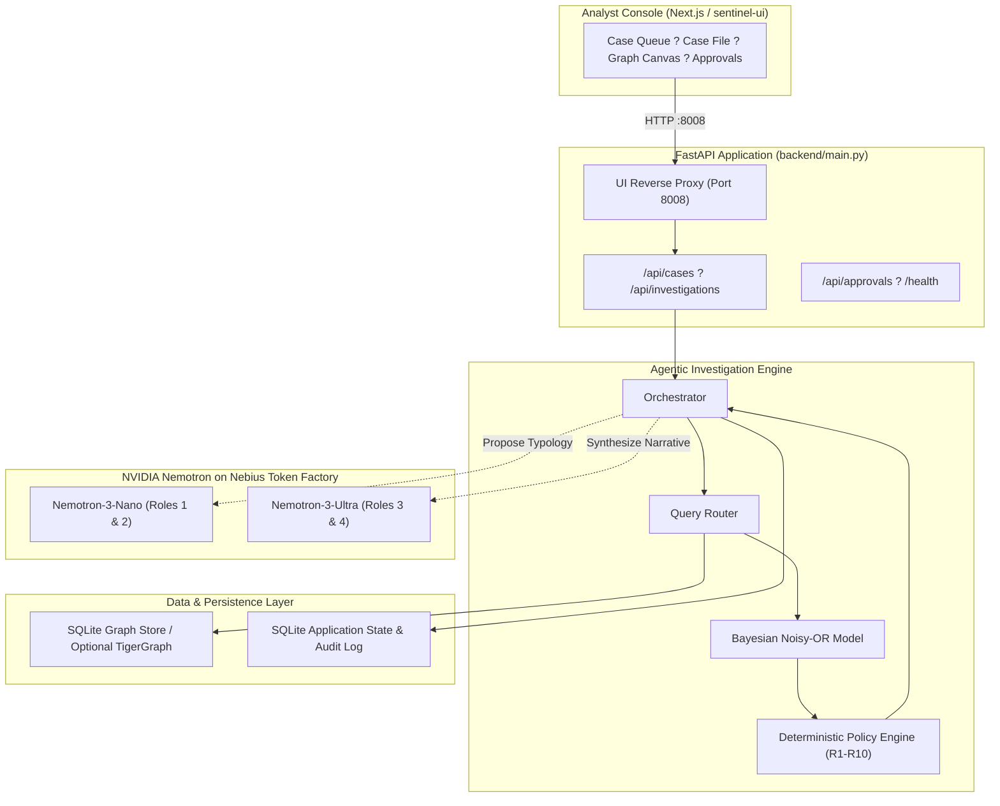

# Sentinel Graph: Agentic Fraud Investigation Platform

> An autonomous, evidence-grounded, policy-controlled fraud investigation platform powered by TigerGraph GraphRAG, calibrated Bayesian risk scoring, **NVIDIA Nemotron LLMs on Nebius Token Factory**, and human-in-the-loop governance.

<p align="center">
  <a href="https://www.python.org/"></a>
  <a href="https://fastapi.tiangolo.com/"></a>
  <a href="https://nextjs.org/"></a>
  <a href="https://build.nvidia.com/nvidia"></a>
  <a href="./docs/TECHNICAL_VALIDATION.md"></a>
  <a href="./docs/BENCHMARK.md"></a>
  <a href="./LICENSE"></a>
</p>

---

## 0. Quickstart (5 Minutes, Zero Credentials)

```bash
git clone PUBLIC_REPO_URL
cd hhgoa-sentinel-console
docker compose up --build
# Open http://localhost:8008
```

The single-container demo:
- **Hosted demo**: console at <https://sentinel-ui-nu.vercel.app>, API at <https://sentinel-console-api.onrender.com> (Vercel proxies to Render; `DEMO_MODE=1`).
- **One Container, One URL (`:8008`)**: The FastAPI backend and Next.js console (`sentinel-ui`) are co-hosted inside one container.
- **Hermetic Synthetic Graph**: Rebuilds the SQLite graph store from committed synthetic CSVs (`data/synthetic/`) in ~3 seconds (`GRAPH_BACKEND=local`). No external cluster required.
- **Default Demo Mode (`DEMO_MODE=1`)**: every case view, re-run and benchmark endpoint is a replay of `cases/*.json` — no run, no rewrite, no spend. Analyst Q&A is the one live path: answers are cached on disk and capped per IP and per day, so only a genuinely new question reaches Nemotron.
- **Live Nemotron Calls (Optional)**: Set `NEBIUS_API_KEY` in `docker-compose.yml` and set `DEMO_MODE=0` (see [docs/DEPLOY.md](./docs/DEPLOY.md)).

---

## Table of Contents

0. [Quickstart](#0-quickstart-5-minutes-zero-credentials)
1. [Problem Statement](#1-problem-statement)
2. [Solution Overview](#2-solution-overview)
3. [NVIDIA Nemotron & Nebius Token Factory](#3-nvidia-nemotron--nebius-token-factory)
4. [Key Capabilities](#4-key-capabilities)
5. [Architecture](#5-architecture)
6. [Agentic Workflow](#6-agentic-workflow)
7. [Technology Stack](#7-technology-stack)
8. [Repository Structure](#8-repository-structure)
9. [Requirements](#9-requirements)
10. [Installation & Local Run](#10-installation--local-run)
11. [API Overview](#11-api-overview)
12. [Testing & Quality Gates](#12-testing--quality-gates)
13. [Configuration Options](#13-configuration-options)
14. [Limitations & Disclosures](#14-limitations--disclosures)
15. [Third-Party Code & Attribution](#15-third-party-code--attribution)
16. [What Changed During the Submission Period](#16-what-changed-during-the-submission-period-from-2026-08-26)
17. [License](#17-license)

---

## 1. Problem Statement

Financial fraud detection systems in modern banking face three structural bottlenecks:

1. **Black-Box Score Opacity**: Machine learning models output risk scores (e.g. `0.87`) without transparent, verifiable explanations. Analysts cannot immediately verify *why* an alert triggered or what multi-hop relationships justify blocking funds.
2. **Investigation Latency & Disjoint Systems**: Analysts manually correlate cards, device fingerprints, transaction logs, merchant categories, and dispute histories across disparate data silos.
3. **Absence of Policy Governance**: Unsupervised LLM outputs cannot be trusted with unilateral authority to freeze bank accounts or decline legitimate payments.

---

## 2. Solution Overview

The **Sentinel Graph** platform transforms raw fraud alerts into complete, auditable, and policy-governed investigations:

$$\text{Alert} \longrightarrow \text{Graph Evidence} \longrightarrow \text{Nemotron Advisory} \longrightarrow \text{Bayesian Risk} \longrightarrow \text{Policy Engine Gate} \longrightarrow \text{Human Approval} \longrightarrow \text{Audit Trail}$$

Core architectural pillars:
- **Local SQLite Graph Store (Default) / Optional TigerGraph**: Graph traversal engine queries device sharing, transaction velocity, card-testing rings, and merchant clusters.
- **GraphRAG Context Retrieval**: Evidence cards assemble 30-day card histories, cross-account device sharing, and past dispute records.
- **NVIDIA Nemotron LLMs via Nebius Token Factory**: 4 specialized roles advise the investigation with fraud pattern typologies, verification drafts, and FinCEN SAR narratives.
- **Governed Policy Engine (Rules R1?R10)**: Deterministic policy engine verifies all actions; the LLM advises, but the policy engine decides.
- **Explainable Noisy-OR Bayesian Modeling**: Calibrated probability updates across independent evidence channels.

---

## 3. NVIDIA Nemotron & Nebius Token Factory

NVIDIA **Nemotron 3** reasoning models, served via **Nebius Token Factory** (`https://api.tokenfactory.nebius.com/v1`), provide natural language reasoning on top of deterministic graph evidence.

### Strict Governance Principle:
> *"Nemotron proposes, the deterministic policy engine decides."*

| Role | Verb | Tier / Model ID | Role Description |
|---|---|---|---|
| **Role 1: Pattern Classifier** | Propose | `nvidia/NVIDIA-Nemotron-3-Nano-30B-A3B` (Nano) | Proposes fraud typology (`card_testing`, `card_not_present`, `account_takeover`) grounded strictly in finite evidence cards. |
| **Role 2: Verification Drafter** | Draft | `nvidia/NVIDIA-Nemotron-3-Nano-30B-A3B` (Nano) | Generates plain-text customer verification prompts when additional confirmation is needed. |
| **Role 3: Narrative & SAR Drafter** | Synthesize | `nvidia/Nemotron-3-Ultra-550b-a55b` (Ultra) | Synthesizes FinCEN-compliant Suspicious Activity Report (SAR) narrative citing explicit evidence IDs. |
| **Role 4: Interactive Analyst Q&A** | Answer | `nvidia/Nemotron-3-Ultra-550b-a55b` (Ultra) | Answers investigator questions grounded strictly in case evidence cards, refusing out-of-scope inquiries. |

---

## 4. Key Capabilities

- **Multi-Hop Ring Discovery**: Traces shared hardware fingerprints, browser headers, and proxy IPs across multiple customer accounts.
- **Evidence Ledger with Provenance**: Every factual claim is mapped to an explicit evidence card reference (`graph`, `identity`, `policy`, `txn`).
- **Bayesian Risk Decomposition**: Combines baseline risk scores with real-time velocity and device evidence via Noisy-OR updates.
- **Governed Human Approvals**: Sensitive financial interventions (e.g. `BLOCK_ALL_CARDS`, law enforcement referral) require authenticated human sign-off.
- **Built-in Spend Protections**: Per-IP hourly limiter (20 calls/hr), global daily cap (200 calls/day), and zero-500 fallback resilience.

---

## 5. Architecture



---

## 6. Agentic Workflow

1. **Trigger & Retrieval**: Case pack alert loads into the orchestrator; initial transaction and identity records retrieved.
2. **Graph Expansion**: Router queries 2-hop graph neighborhood (co-used devices, IP subnets, 30-day velocity).
3. **Nemotron Advisory**: Nemotron Nano inspects evidence cards and proposes a candidate fraud pattern.
4. **Bayesian Risk Calculation**: Noisy-OR combines prior transaction score with graph risk channels.
5. **Policy Verification**: Rules engine (R1?R10) validates constraints. If customer verification exists (R1), score overrides down to benign; if multi-card ring exists (R8/R10), escalation triggers.
6. **SAR & Action Dispatch**: If fraud is confirmed, Nemotron Ultra drafts the SAR narrative when Token Factory is configured (a grounded template writes it otherwise), and next-best-actions are queued for execution or approval.

---

## 7. Technology Stack

- **Backend Runtime**: Python 3.12, FastAPI, Uvicorn, Pydantic v2
- **Graph Layer**: Local SQLite graph engine (default) / Optional TigerGraph pyTigerGraph driver
- **Frontend Console**: Next.js 15 (App Router), React 19, TypeScript, Tailwind CSS, HTML5 Canvas
- **LLM Inference**: NVIDIA Nemotron-3-Nano-30B, Nemotron-3-Ultra-550b via Nebius Token Factory
- **Deployment**: Docker multi-stage single-container build, Render Blueprint (`render.yaml`)

---

## 8. Repository Structure

```
hhgoa-sentinel-console/
??? backend/                      # FastAPI backend application
?   ??? agents/                   # Orchestrator and agent loop
?   ??? graph/                    # Query router and SQLite graph traversal
?   ??? llm/                      # Nebius Token Factory client & 4 roles
?   ??? policies/                 # Deterministic policy engine (R1-R10)
?   ??? risk/                     # Bayesian Noisy-OR risk modeling
?   ??? config.py                 # Configuration and environment settings
?   ??? main.py                   # FastAPI application entrypoint & UI proxy
??? sentinel-ui/                  # Analyst Console (Next.js 15 Standalone)
?   ??? src/app/                  # App Router pages (cases, approvals, ring)
?   ??? src/components/console/   # CasePanel, QueueRail, GraphCanvasView, etc.
?   ??? src/lib/                  # API client, TanStack Query hooks, contract
?   ??? e2e/                      # Playwright E2E smoke tests
?   ??? NOTICE.md                 # Upstream attribution and provenance details
??? data/
?   ??? synthetic/                # 100% synthetic CSVs (transactions, identity, cases)
??? cases/                        # 20-case pack answer files + ground_truth.json
??? docs/                         # Technical documentation
?   ??? BENCHMARK.md              # 3-Arm ablation benchmark results
?   ??? DEMO.md                   # 3-minute walkthrough & showcase cases
?   ??? DEPLOY.md                 # Single-container & Render deployment guide
?   ??? FEEDBACK_NOTES.md         # Engineering ledger & measured telemetry
?   ??? FINAL_REPORT.md           # Session-verified final report
?   ??? UI_PROVENANCE.md          # Upstream UI provenance & audit log
?   ??? screenshots/              # 7 high-resolution console screenshots
??? scripts/                      # Evaluation, benchmark, and screenshot scripts
??? tigergraph/                   # GSQL queries and schema definitions
??? tests/                        # Pytest suite (355 passed / 9 skipped)
??? Dockerfile                    # Multi-stage production container build
??? docker-compose.yml            # Single-container deployment configuration
??? render.yaml                   # Hosted Render Blueprint specification
??? pyproject.toml                # Python project configuration
??? requirements.txt              # Pinned Python dependencies
??? LICENSE                       # MIT License (Mohammed Yasin Shaik)
??? README.md                     # Project documentation
```

---

## 9. Requirements

- **Docker**: Recommended for instant zero-dependency execution.
- **Python**: Version `3.12` (tested and verified).
- **Node.js**: Version `20+` (for local frontend development).
- **Nebius Token Factory API Key**: Optional (system defaults to zero-credit replay mode).

---

## 10. Installation & Local Run

### Method A: Single-Container Docker (Recommended)
```bash
git clone PUBLIC_REPO_URL
cd hhgoa-sentinel-console
docker compose up --build
# Open http://localhost:8008
```

### Method B: Local Native Development
```bash
# 1. Backend setup
python -m venv .venv
# Windows: .\.venv\Scripts\activate | Linux/macOS: source .venv/bin/activate
pip install -r requirements.txt
python -m backend.scripts.prepare_data
uvicorn backend.main:app --port 8000

# 2. Frontend setup (in a separate terminal)
cd sentinel-ui
npm ci
NEXT_PUBLIC_API_BASE=http://127.0.0.1:8000 npm run dev
# Open http://localhost:3000
```

---

## 11. API Overview

| Endpoint | Method | Description |
|---|---|---|
| `/health` | `GET` | System health check (`status`, `nebius_available`, `graph_mode`) |
| `/api/cases` | `GET` | List case pack summaries and priority rankings |
| `/api/investigations/{id}` | `GET` | Full investigation result and evidence ledger |
| `/api/investigations/{id}/graph` | `GET` | Subgraph nodes and links for canvas rendering |
| `/api/investigations/{id}/risk` | `GET` | Bayesian risk breakdown by evidence channel |
| `/api/cases/{id}/ask` | `POST` | Grounded analyst interactive Q&A via Nemotron Ultra |
| `/api/approvals` | `GET` | List pending and decided human-in-the-loop actions |
| `/api/llm/status` | `GET` | Nebius Token Factory call log telemetry and spend caps |

---

## 12. Testing & Quality Gates

The repository enforces strict automated quality gates:

```bash
# 1. Run Python test suite (355 passed, 9 skipped)
pytest tests/ -q -rs

# 2. Run Python lint gate (0 findings)
ruff check backend scripts tests

# 3. Run UI lint & typecheck gates (0 errors)
cd sentinel-ui
npx eslint . --max-warnings=0
npx tsc --noEmit

# 4. Run Playwright browser smoke suite (32/32 passed)
node e2e/smoke.mjs
```

---

## 13. Configuration Options

Key environment variables in `.env` (see `.env.example`):

| Variable | Default | Purpose |
|---|---|---|
| `GRAPH_BACKEND` | `local` | Graph engine (`local` SQLite or `tigergraph`) |
| `DEMO_MODE` | `1` | Replay precomputed cases; runs and benchmark writes are refused, Q&A is cache-first and capped |
| `NEBIUS_API_KEY` | `""` | Optional API key for live NVIDIA Nemotron inferences |
| `NEBIUS_BASE_URL` | `https://api.tokenfactory.nebius.com/v1` | Nebius Token Factory OpenAI-compatible endpoint |
| `NEBIUS_MODEL_NANO` | `nvidia/NVIDIA-Nemotron-3-Nano-30B-A3B` | Roles 1 & 2 model identifier |
| `NEBIUS_MODEL_ULTRA` | `nvidia/Nemotron-3-Ultra-550b-a55b` | Roles 3 & 4 model identifier |
| `LLM_DAILY_CALL_CAP` | `200` | Global daily call protection cap |
| `LLM_CALLS_PER_IP_PER_HOUR`| `20` | Per-IP rate limiter |
| `APPROVAL_TOKEN` | `""` | Shared secret required for approval decisions (`X-Approval-Token`); unset means production refuses approvals, development allows them with a warning |
| `CORS_ORIGINS` | localhost:3000 / :8008 | Comma-separated browser origins allowed to call the API directly |

---

## 14. Limitations & Disclosures

- **Real-Dataset Caveat & Benchmark Scope**: On the original hackathon round's real dataset (not redistributed), verdict accuracy was 60% (12/20) and pattern accuracy 85% (17/20). The synthetic benchmark checks pipeline correctness, not real-world accuracy.
- **Synthetic Evaluation Data**: Shipped benchmark cases and closed histories are 100% synthetic and generated via `scripts/make_synthetic_data.py`. No confidential banking records are included.
- **Single-Node Application State**: SQLite application state (`data/app/app.db`) is optimized for single-instance or edge deployment; horizontal clustering requires PostgreSQL.
- **Client IP Limiter behind Shared NAT**: The per-IP limiter inspects client IP; behind shared proxies, users share an hourly bucket with the global daily cap acting as backstop.

---

## 15. Third-Party Code & Attribution

The Next.js analyst console in `sentinel-ui/` was forked and extensively reworked from the "Sentinel v2" prototype created by Team CollabUp (Hacker House Goa 2026, `https://github.com/r-rishit27/hacker_house` commit `7bcea03`).

### What comes from CollabUp:
- Base layout scaffolding, Tailwind color tokens, and visual styling.
- Foundational SVG/Canvas layout concepts.

### What was rewritten locally for Sentinel Graph:
- **`src/lib/hhgoa.ts`**: Complete hand-crafted contract mirroring the real FastAPI backend.
- **`src/lib/api.ts` & `src/lib/hooks.ts`**: TanStack Query data fetching layer wired to HHGOA endpoints.
- **`src/components/console/*`**: All views rebuilt to support the Nemotron advisory panel, agree/override badges, evidence card provenance, and Approvals drawer.
- **Removed Dead Code**: Deleted upstream mock API, unused UI components, and mock role-switching state.

> **Attribution & Licensing Status**:  
> `TODO: Confirm upstream licensing terms with Team CollabUp (upstream repository r-rishit27/hacker_house contains no LICENSE file; attribution is provided in sentinel-ui/NOTICE.md in good faith).`

For full commit history and provenance details, see [docs/UI_PROVENANCE.md](./docs/UI_PROVENANCE.md).

---

## 16. What Changed During the Submission Period (from 2026-08-26)

- **2026-08-26 ? Baseline Architecture**: Initial deterministic policy engine (R1?R10) and TigerGraph GSQL graph schema.
- **2026-10-23 ? NVIDIA Nemotron & Hybrid Governance**:
  - Integrated Nebius Token Factory with NVIDIA Nemotron (Nano 30B, Super 120B, Ultra 550B) across 4 roles with strict "propose, decide" separation.
  - Implemented spend protections: per-IP limiter, 200/day global cap, JSONL audit logging (`/api/llm/status`), and zero-500 fallbacks.
  - Built judge-ready single-container Docker image (`:8008`) and Render Blueprint (`render.yaml`).
  - Rebuilt `sentinel-ui` on production API contract; purged obsolete CSVs.
- **2026-10-24 ? Stress Testing & Final Submission Hardening**:
  - Enhanced synthetic data generator with overlapping score distributions ($[0.52, 0.74]$ benign, $[0.65, 0.92]$ fraud) and stress scenarios (`CASE-009` ring FN, `CASE-007` emergency FP).
  - 3-Arm evaluation: Graph Agent ($F_1 = 1.0000$) vs Score-Only ($F_1 = 0.9333$) vs Plain LLM ($F_1 = 0.0000$).
  - Full test suite verified at **355 passed, 9 skipped**; `ruff` and `eslint` clean with 0 warnings.
  - Gitleaks scanned 93 commits: **0 secrets found**.
  - Captured 7 high-resolution (1536?1024) UI screenshots in `docs/screenshots/`.

---

## 17. License

This project is licensed under the **MIT License** ? see the [LICENSE](./LICENSE) file for details.

Copyright (c) 2026 Mohammed Yasin Shaik. All rights reserved.
